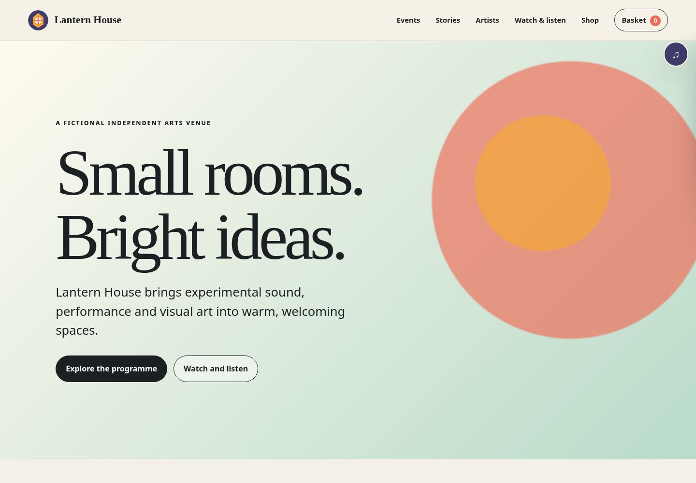
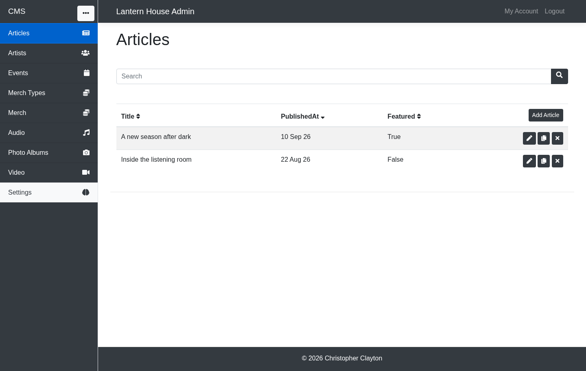

# HypnoTech

[](https://github.com/camelofcode/HypnoTech/actions/workflows/ci.yml)

HypnoTech is a modular ASP.NET Core engine for content-managed websites. It combines
a convention-driven CMS with reusable Common, Ecommerce, Media, Frontend, and MongoDB
components. It is aimed at developers building bespoke, content-heavy sites that need
an editable admin application without surrendering control of the public website's
models, rendering, or data-access design.

The engine currently provides:

- dynamic CMS controllers, forms, tables, validation, uploads, and model registration;
- account, authentication, email, configuration, navigation, and logging components;
- ecommerce models, administration, cart/checkout support, and the legacy PayPal path;
- media models, administration, and frontend player support;
- swappable repository contracts with MongoDB implementations;
- self-hosted frontend assets with reproducible npm-based bundle generation.

## Status

Version 1.0 is the first stable public and portfolio baseline. The engine has an
original runnable example, native async request and persistence paths, layered
unit/integration/architecture coverage, and a focused Chromium/Firefox/WebKit browser
suite. Existing production consumers remain pinned to the preserved legacy branch,
and MongoDB Server 4.0.3 compatibility remains a required CI gate.

See [PUBLIC_READINESS_PLAN.md](PUBLIC_READINESS_PLAN.md) for the phased roadmap and
work record, [docs/architecture.md](docs/architecture.md) for the design,
[docs/compatibility.md](docs/compatibility.md) for tested versions, and
[docs/limitations.md](docs/limitations.md) for intentionally unsupported or deferred
areas. The automated gates are described in [docs/ci.md](docs/ci.md) and
[docs/code-quality.md](docs/code-quality.md).

## Lantern House example

The repository includes an entirely fictional arts-venue site demonstrating the
generated CMS, partial-page navigation, persistent audio player, Media, Ecommerce,
uploads, responsive rendering, and the deliberate Admin/Website boundary.





See the [example guide](examples/README.md) for the one-command Podman launcher,
development login, feature inventory, and browser journeys.

## Build from a fresh clone

Prerequisites:

- a .NET 10 SDK compatible with `global.json`;
- Node.js 22 or newer and npm 11.16.0 for rebuilding frontend assets.
- Docker or Podman with its Docker-compatible API socket for MongoDB integration tests.

```bash
dotnet restore HypnoTech.slnx
dotnet build HypnoTech.slnx -c Release --no-restore
dotnet format HypnoTech.slnx --no-restore --verify-no-changes --verbosity minimal
npm ci
npm run check:frontend
./tests/run-end-to-end.sh
dotnet test HypnoTech.slnx -c Release --no-build
```

Generated frontend assets are committed, so normal .NET consumers do not need npm.
Use npm when changing frontend source or verifying that committed bundles are current:

```bash
npm run build:frontend
npm run check:frontend
```

The unit, architecture, and MongoDB characterisation suites are under `tests/`. The
MongoDB suite runs the same repository contracts against production MongoDB 4.0.3 and
pinned MongoDB 8.0 and 9.0 releases. Podman setup, focused commands, and coverage
instructions are in [`tests/README.md`](tests/README.md). The runnable original
[`Lantern House example`](examples/README.md) demonstrates the CMS, Media, Ecommerce,
Frontend, and MongoDB modules. Its focused Playwright suite runs with
`./tests/run-end-to-end.sh`.

Repository-wide instructions for coding agents are in [AGENTS.md](AGENTS.md). The
workflow-backed authoring and verification skills under [`.agents/skills/`](.agents/skills/)
capture the compatibility, async, testing, external-HTTP, and validation conventions
used while preparing the engine for release.

Public NuGet packages are not published yet. The package audit, local-feed rehearsal,
nuget.org Trusted Publishing setup, and future consumer migration are defined in the
[NuGet packaging plan](docs/nuget-packaging-plan.md).

## Repository layout

Source projects are grouped physically by functional area:

- `src/Cms/` — dynamic CMS, contracts, MongoDB implementation, and frontend source;
- `src/Common/` — shared services, models, security, email, and DAL contracts;
- `src/Ecommerce/` — ecommerce domain, admin/frontend support, DAL, and frontend source;
- `src/Media/` — media domain, frontend support, DAL, and frontend source;
- `src/Frontend/` — general website helpers and shared frontend source;
- `src/Persistence/` — shared MongoDB infrastructure;
- `tests/` — xUnit v3 unit, architecture, Testcontainers integration, and Playwright tests;
- `examples/` — the fictional Lantern House admin, public website, and safe seed data;
- `tools/` — deterministic frontend build tooling.

`*.Frontend` runtime projects contain committed `wwwroot` output. Similarly named
frontend-asset directories contain authored JavaScript/SCSS and remaining historical
browser snapshots; exact root npm dependencies supply jQuery and Knockout. Do not edit
generated `wwwroot` bundles directly.

## Scope boundaries

This repository contains only the reusable engine. Private Esoteric and SelfHypnosis
sites, their content, branding, seed data, and imagery are deliberately excluded.
Additional payment-provider work described in `ecommerce-payments-plan.md` is also
outside the current public-readiness programme.

## Security, contributions, and licensing

Report vulnerabilities using [SECURITY.md](SECURITY.md). Contribution expectations are
in [CONTRIBUTING.md](CONTRIBUTING.md), and dependency attributions are in
[THIRD_PARTY_NOTICES.md](THIRD_PARTY_NOTICES.md).

HypnoTech is **source-available for noncommercial use** under the
[PolyForm Noncommercial License 1.0.0](LICENSE.md). It is not OSI-approved open-source
software because commercial use is restricted. Christopher Clayton retains the right
to use and license his own work commercially. Other commercial use requires a separate
written agreement; see [COMMERCIAL-LICENSE.md](COMMERCIAL-LICENSE.md).
