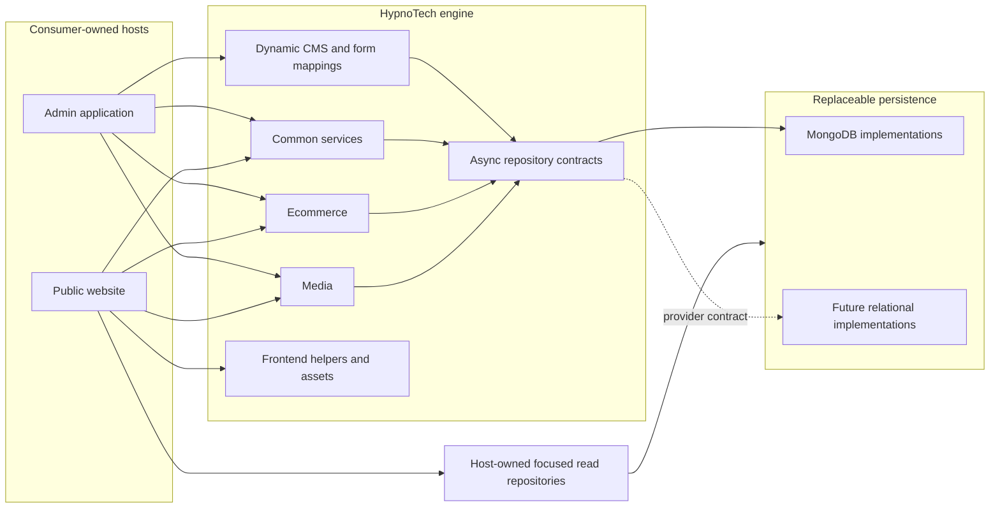

# Architecture

HypnoTech is a set of ASP.NET Core libraries used by a host application. It is organised
around four functional modules—CMS, Common, Ecommerce, and Media—with shared frontend
and MongoDB infrastructure. The physical project layout matches those functional areas
under `src/`; production consumers remain pinned to the preserved support branch whose
project paths are unchanged.



The Admin host owns edit mappings and the generic CMS write path. The public website
does not reference CMS/Admin assemblies; it owns focused read repositories and may use
different models or persistence even when both hosts read the same underlying data.

## Layers and modules

| Area | Responsibility | Current projects |
| --- | --- | --- |
| CMS contracts | Provider-facing CMS requests, responses, and repository interfaces | `HypnoTech.Cms.Contracts` |
| CMS application/web | Dynamic controllers, form mapping, validation, views, services, uploads | `HypnoTech.Cms` |
| Common | Shared models, services, security, email, and repository contracts | `HypnoTech.Common*` |
| Ecommerce | Products, orders, discounts, postage, settings, cart/checkout, admin UI | `HypnoTech.Ecommerce*` |
| Media | Media models, administration, player/frontend support | `HypnoTech.Media*` |
| Persistence | MongoDB options, repository base code, backup and logging infrastructure | `HypnoTech.MongoDb` and module `*.MongoDb` projects |
| Frontend | General MVC/Ajax helpers plus authored and generated browser assets | `HypnoTech.Frontend*` and module frontend projects |

The `*.Dal` projects contain provider-neutral repository contracts. The current
`*.Dal.MongoDb` projects implement them. CMS uses its own contract project and generic
MongoDB repository. Entity Framework Core providers are deliberately deferred until
the async contracts and provider-independent behaviour suite are established.

## Dynamic CMS flow

The central CMS path is convention driven:

1. A host registers model metadata in `FormClassMapping` and the relevant registries.
2. `CmsControllerFeatureProvider` and the route convention expose a closed generic
   `CmsController<T>` for each registered model.
3. `CmsController<T>` delegates list, form, validation, upload, and mutation work to
   `ICmsService<T>`.
4. `ICmsService<T>` uses `ICmsRepository<T>` and mapping metadata rather than a
   model-specific controller/repository pair.
5. `CmsRepository<T>` translates mapped members to BSON names, performs MongoDB CRUD,
   paging, search, ordering, and child population.

This removes repetitive admin CRUD code but creates a broad compatibility surface.
Routes, registry ordering, mapping metadata, BSON member names, reflection behaviour,
form rendering, and repository semantics all need characterisation tests before major
refactoring.

## Host registration

A consuming host composes the modules through `IServiceCollection` extension methods.
The current MongoDB setup is intentionally modular:

```csharp
services.UseMongoDbForCms(configuration);
services.UseMongoDbForCommon(configuration);
services.UseMongoDbForEcommerce(configuration);
services.UseMongoDbForMedia(configuration);
```

This seam is intended to support other persistence providers later. A host also calls
the relevant CMS, Ecommerce, Media, and frontend registration/configuration methods.
The Phase 4 example applications will become the canonical executable composition.

Admin and public website hosts have different dependency boundaries. The Admin host
owns `FormClassMapping` registrations and the CMS repository provider. A public website
may share provider-neutral model types, but owns its focused read repositories and
persistence mappings; it must not reference `HypnoTech.Cms`, an Admin mapping project,
or `HypnoTech.Cms.MongoDb`. Besides keeping edit behavior server-side, this prevents
CMS controllers, editing concerns, and admin static assets from flowing into the public
application. The two hosts may use different DAL or ORM implementations entirely.

## Frontend assets

Authored JavaScript and SCSS live in the frontend-asset directories. Historical browser
snapshots remain under `lib/`; jQuery and Knockout are exact root npm development
dependencies so the lockfile and security tooling can identify their versions.
`tools/build-frontend.mjs` concatenates and minifies JavaScript and compiles/minifies
CMS styles into the runtime projects' `wwwroot` directories.

The generated outputs are committed so a .NET consumer does not need Node.js. Runtime
assets remain self-hosted. The root `package-lock.json` and exact devDependency versions
make regeneration reproducible; `npm run check:frontend` detects stale output.

See [frontend-integration.md](frontend-integration.md) for the consuming-host contract,
including partial navigation, persistent player and cart components, shared events,
page scripts, and intentional full-document boundaries.

## Frontend request execution

`UseHypnoTech` prepares the host script/style manifest and content hashes once during
service registration, so layout tag helpers only perform in-memory rendering. An async
hosted initializer loads the public navbar before the server accepts requests, while the
authenticated refresh route uses the same async MongoDB path.

Uploaded images and media are read asynchronously with request cancellation and preserve
the existing cache and range-response contract. Partial-navigation views render through
MVC's async APIs, serialize their established JSON envelope in memory, and write it with
`HttpResponse.WriteAsync`; HypnoTech does not enable synchronous Kestrel or IIS response
I/O.

Serilog's synchronous sink contract is isolated behind a bounded background queue. The
MongoDB sink can retain its required `Emit` implementation without performing database
work on request threads.

## Building CMS models

The dynamic controller convention is configured through the fluent
`FormClassMapping<T>` API and a provider-specific persistence mapping. The public
Lantern House models demonstrate the supported field families, relationships,
ordering, nested lists, uploads, generated values, roles, search and default sorting.

See [cms-models.md](cms-models.md) for an end-to-end host guide with executable example
code.

## Compatibility boundaries

The current production baseline is engine commit `95c9f6a`, MongoDB.Driver 3.4.3, and
MongoDB Server 4.0.3. Until targeted tests and a migration plan say otherwise:

- persisted BSON names and collection names are contracts;
- public namespaces, assemblies, routes, and static asset paths remain stable;
- public repository and I/O-bound service contracts on `main` are async-only;
- ordered moves swap adjacent items and treat collection boundaries as no-ops;
- generated bundles change only through their source and build tool;
- production sites remain on the preserved support branch.

See [compatibility.md](compatibility.md) and the living
[public-readiness plan](../PUBLIC_READINESS_PLAN.md) for the detailed gates.
